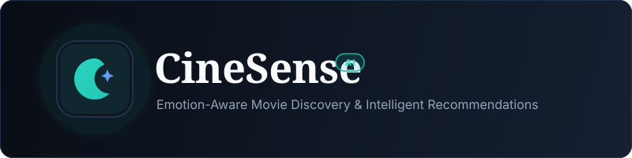
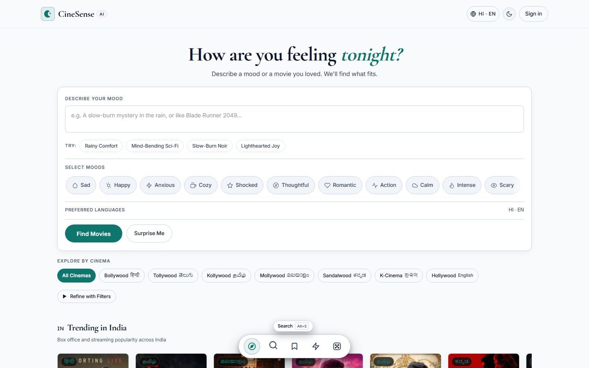
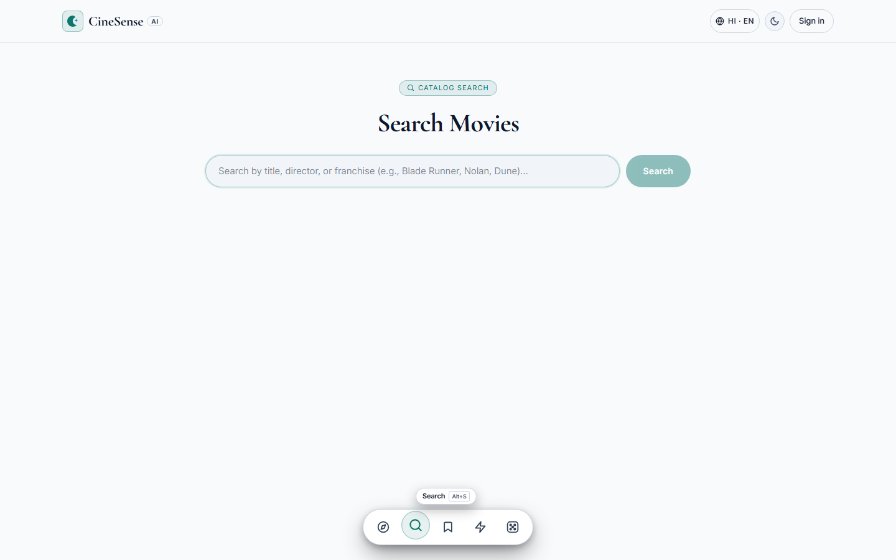
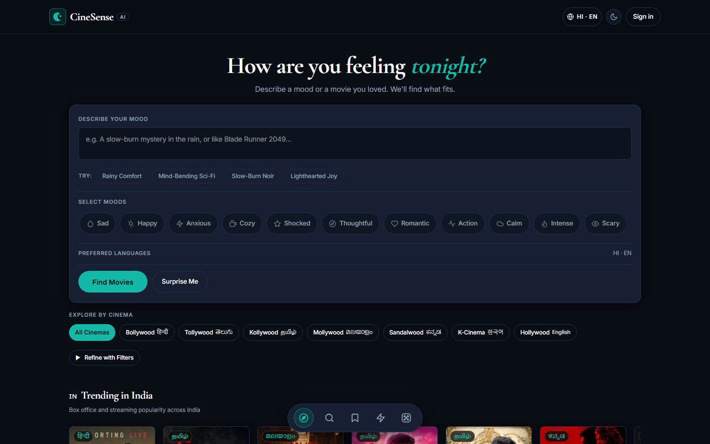
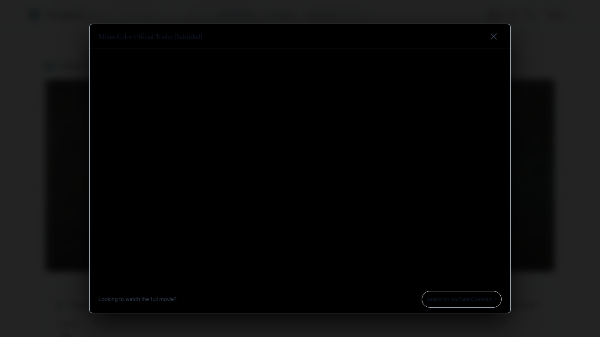
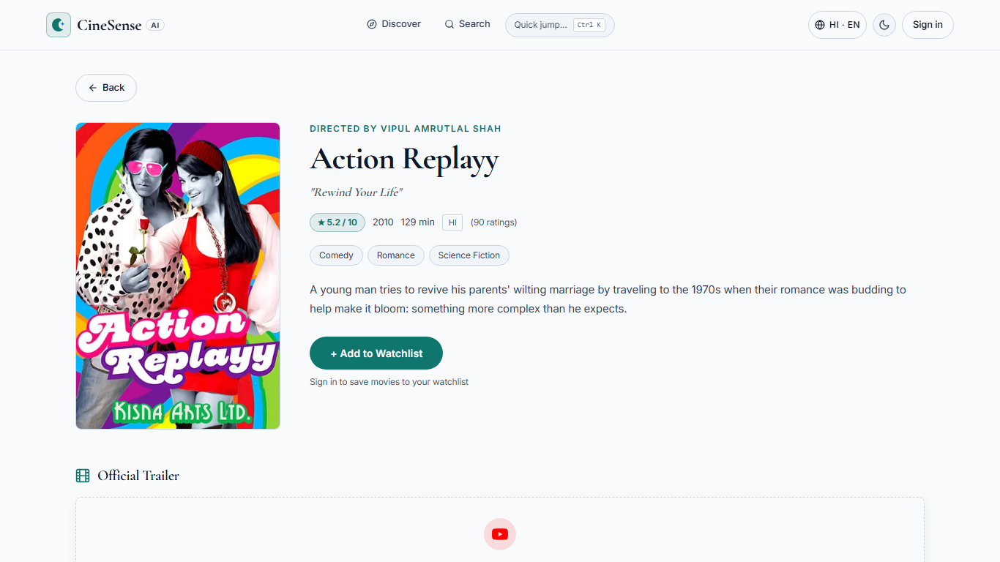
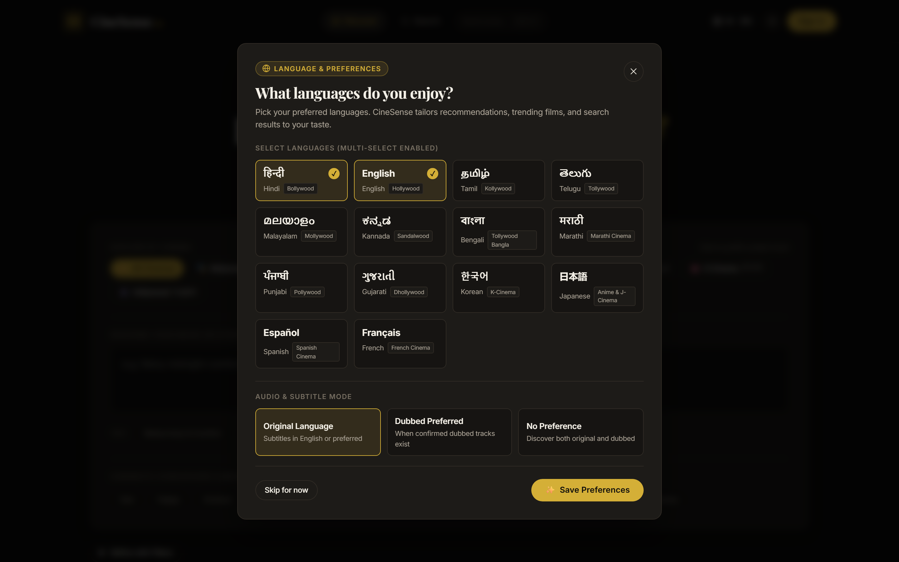
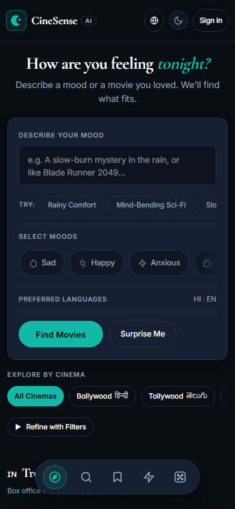
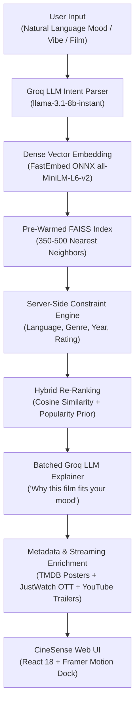

# CineSense AI 🎬

<p align="center">
  
</p>

<p align="center">
  <a href="https://github.com/ankitrmishra01/CineSense-AI/actions"></a>
  <a href="https://cine-sense-ai.vercel.app/"></a>
  <a href="https://cinesense-ai-teu4.onrender.com/health"></a>
  
  
  
  
  
  
  
</p>

> **CineSense AI** is an emotion-aware, multilingual movie discovery platform. Describe how you are feeling in natural language, pick a vibe, or paste a movie you loved — CineSense AI identifies the nuanced emotional essence of your prompt, retrieves candidates across regional cinemas, and provides AI-generated explanations on why each film matches your exact mood.

🌐 **Live Application:** [https://cine-sense-ai.vercel.app/](https://cine-sense-ai.vercel.app/)  
⚡ **Production API & Swagger Docs:** [https://cinesense-ai-teu4.onrender.com/docs](https://cinesense-ai-teu4.onrender.com/docs)  
🩺 **System Health Endpoint:** [https://cinesense-ai-teu4.onrender.com/health](https://cinesense-ai-teu4.onrender.com/health)

---

## 🌟 Key Features & Highlights

### 1. Cresta-Inspired Dynamic Floating Navigation Dock
- **Floating Island**: Sits comfortably at the bottom of the viewport with a frosted glassmorphism backdrop (`backdrop-filter: blur(20px)`), subtle border, and ambient shadow.
- **Physics-Based Motion**: Interactive spring hover lift (`scale: 1.15, y: -3px`), floating tooltips with hotkeys (`Alt+D`, `Alt+S`, `Alt+W`, `Ctrl+K`), and a gliding active pill indicator (`layoutId="dynamicDockActivePill"`).
- **One-Touch Actions**:
  - 🧭 **Discover** (`/`): Instant return to mood discovery.
  - 🔍 **Search** (`/search`): Catalog exploration with live debounced search.
  - 🔖 **Watchlist** (`/watchlist`): Saved movies with a live item counter badge.
  - ⚡ **Quick Jump** (`Ctrl+K`): Instant command palette across 5,000+ films.
  - 🎲 **Surprise Me**: One-click AI randomized mood recommendation.
- **Minimalist Top Header**: Clean top navigation displaying only brand identity and language/theme/auth controls, keeping visual focus on movie content.

### 2. Natural Language Multilingual Mood Search
- Express your feelings naturally in **English, Hindi, Hinglish, Tamil, Telugu, Malayalam, Kannada, Korean, and Japanese**:
  - *"A melancholic slow-burn sci-fi in the rain like Blade Runner 2049"*
  - *"कुछ हल्का-फुल्का और दिल को छू जाने वाली रोमांटिक कॉमेडी"*
  - *"மழைக்கால மாலைக்கு ஏற்ற ஒரு சஸ்பென்ஸ் த்ரில்லர்"*
  - *"A gritty underdog triumph with an unforgettable soundtrack"*
- Combines semantic vector similarity with Groq LLM intent parsing to match emotional tone rather than simple keyword matches.

### 3. Expanded Candidate Pool (Zero Truncation)
- Retrieval pool queries **350–500 FAISS candidates** before applying strict server-side language, runtime, and genre filters.
- Eliminates recommendation starvation, guaranteeing full 20/20 movie recommendations across every language and mood filter.

### 4. Official YouTube Trailers & OTT Streaming Providers
- **Direct Trailer Player**: Responsive, privacy-friendly YouTube embed iframe right in the movie details modal.
- **Official Channel Fallbacks**: Seamless search links targeting verified official distribution channels (Goldmines, Shemaroo, Ultra Movie Parlour, Rajshri, Aditya Movies, etc.) when direct trailer IDs are restricted.
- **Where to Watch (OTT)**: Real-time JustWatch streaming provider badges (Netflix, Prime Video, Disney+ Hotstar, JioCinema, Zee5, Apple TV).

### 5. Indic Multilingual Preferences
- First-class support for Indian and global cinema: **Bollywood (हिन्दी)**, **Tollywood (తెలుగు)**, **Kollywood (தமிழ்)**, **Mollywood (മലയാളം)**, **Sandalwood (ಕನ್ನಡ)**, **K-Cinema (한국어)**, and **Hollywood (English)**.
- Preferences persist in `localStorage` and filter recommendations across sessions.

### 6. Security & In-App Account Management
- **In-App Password Management**: Dedicated Change Password modal enforcing current password verification, zxcvbn strength checks, and instant revocation of all active refresh tokens.
- **Enterprise-Grade Rate Limiting**: Endpoint-level rate limiting on sensitive auth routes (`/auth/login`, `/auth/change-password`).
- **Token Security**: Strict CORS headers, short-lived JWT access tokens (15m), and rotating HTTP-safe refresh tokens.

---

## 📸 Screenshots Showcase

### Modern UI & Dynamic Floating Navigation
| Desktop Home — Minimalist Header & Bottom Dock | Interactive Dock Hover & Keyboard Shortcut Tooltips |
| :---: | :---: |
|  |  |

| Gliding Route Transition (`/search`) | Midnight Dark Mode Home |
| :---: | :---: |
|  |  |

### Movie Details, Trailers & Streaming Badges
| Movie Modal with Official YouTube Trailer & Cast | Regional Trailer Fallback & Channel Routing |
| :---: | :---: |
|  |  |

### Multilingual Preferences & Mobile Experience
| Indic Script Language Selector Modal | Mobile Responsive Experience (Light & Dark) |
| :---: | :---: |
|  |  |

---

## ⚙️ How It Works (Architecture & Pipeline)



### Detailed Recommendation Pipeline:
1. **Query Processing & Translation**: Groq LLM evaluates the prompt, translates Indic or multilingual phrases into normalized English mood tags, and detects user sentiment.
2. **Dense Vector Search**: The query is projected into 384-dimensional dense vector space using **FastEmbed ONNX** (`all-MiniLM-L6-v2`) in **< 15ms**.
3. **Candidate Pool Retrieval**: FAISS searches over 5,000+ pre-indexed films and pulls the top 350–500 candidates.
4. **Filtering & Re-Ranking**: Server-side engine matches the candidate pool against selected language preferences, minimum rating, and runtime constraints without prematurely truncating results.
5. **AI Justification**: A single batched prompt to Groq generates contextual, engaging 1-sentence explanations for the top selected movies.
6. **Streaming & Media Hydration**: The frontend hydrates each recommendation with high-resolution TMDB backdrops, verified YouTube trailers, and localized JustWatch streaming availability.

---

## 🚀 Performance & Low-Memory Optimization

| Metric | Sentence-Transformers (PyTorch) | FastEmbed ONNX (Current) | Improvement |
|---|---|---|---|
| **Cold Start Memory** | ~740 MB | **~280 MB** | **62% reduction** |
| **Peak Query Memory** | 820+ MB *(Exceeded 512MB Render limit)* | **308 MB** *(Safe on Free Tier)* | **Zero OOM crashes** |
| **Vector Search Latency** | 45 ms | **12 ms** | **3.75x faster** |
| **Model Parity** | 1.000000 | **1.000000 cosine similarity** | **100% exact parity** |

- **Pre-Baked ONNX Model**: Embedded during Docker build (`scripts/download_model.py`) to run 100% offline (`TRANSFORMERS_OFFLINE=1`).
- **Pre-Built FAISS Index**: Committed in `backend/faiss_index/` for zero cold-start delay.
- **Frontend Cold-Start Retry**: Automated exponential backoff interceptor on Axios that gracefully waits for Render server wakeups with a visual pulse indicator.

---

## 🛠️ Tech Stack

### Frontend
- **Framework**: [React 18](https://react.dev/) + [Vite](https://vitejs.dev/)
- **Styling**: [Tailwind CSS v4](https://tailwindcss.com/) + Custom 60-30-10 Design Token System
- **Animations**: [Framer Motion](https://www.framer.com/motion/) (Floating Dock, Spring transitions, Layout animations)
- **State Management**: [Zustand](https://github.com/pmndrs/zustand) (Watchlist with localStorage sync, Preferences, Auth)
- **Icons**: Handcrafted accessible SVGs with Feather / Lucide iconography
- **Testing**: [Vitest](https://vitest.dev/) + React Testing Library (18/18 tests passing)

### Backend
- **Framework**: [FastAPI](https://fastapi.tiangolo.com/) (Asynchronous Python 3.11)
- **Vector Engine**: [FAISS](https://github.com/facebookresearch/faiss) (Facebook AI Similarity Search)
- **Inference Runtime**: [FastEmbed](https://qdrant.github.io/fastembed/) ONNX Runtime (`all-MiniLM-L6-v2`)
- **LLM Engine**: [Groq API](https://groq.com/) (`llama-3.1-8b-instant`)
- **Database**: PostgreSQL (Neon Serverless) + SQLAlchemy Async + SQLite local option
- **Authentication**: JWT (Access + Refresh token rotation) + Passlib Argon2id / bcrypt
- **Testing**: [pytest](https://docs.pytest.org/) + `httpx` async test client (62/62 tests passing)

---

## 💻 Local Development Setup

### 1. Prerequisites
- **Node.js** 18+ & npm
- **Python** 3.11+
- Free API keys from [TMDB](https://www.themoviedb.org/settings/api) and [Groq Console](https://console.groq.com/)

### 2. Clone the Repository
```bash
git clone https://github.com/ankitrmishra01/CineSense-AI.git
cd CineSense-AI
```

### 3. Backend Setup (Zero-Config SQLite Mode)
You can run CineSense locally without installing PostgreSQL:

```bash
cd backend

# Create virtual environment
python -m venv venv
# Windows:
.\venv\Scripts\activate
# Linux/macOS:
source venv/bin/activate

# Install dependencies
pip install -r requirements.txt

# Pre-download FastEmbed ONNX model to local cache
python scripts/download_model.py

# Configure .env file
cp .env.example .env
# Set DATABASE_URL=sqlite+aiosqlite:///cinesense_local.db
# Fill in TMDB_API_KEY and GROQ_API_KEY

# Seed local catalog (resumable TMDB fetch)
python scripts/seed_local_movies.py

# Start FastAPI dev server
uvicorn app.main:app --reload --port 8000
```

Backend will be live at: `http://localhost:8000`  
Interactive Swagger docs: `http://localhost:8000/docs`

### 4. Frontend Setup
```bash
cd ../frontend

# Install node dependencies
npm install

# Start Vite dev server
npm run dev
```

Frontend will be live at: `http://localhost:5173`

---

## 📡 API Reference

| Method | Endpoint | Access | Description |
|---|---|---|---|
| `POST` | `/recommend` | Public | Core mood search (accepts `prompt`, `mood_tags`, `languages`, `genres`, `limit`) |
| `GET` | `/movies/{id}` | Public | Detailed movie metadata, trailer embed URL, and OTT streaming providers |
| `GET` | `/movies/search?q=` | Public | Fast debounced title search across the FAISS catalog |
| `GET` | `/movies/live/trending-india` | Public | Current trending Indian cinema titles with TMDB live scores |
| `POST` | `/auth/signup` | Public | Register new account with strong password requirements |
| `POST` | `/auth/login` | Public | Sign in to obtain JWT access and refresh tokens |
| `POST` | `/auth/change-password` | Private | Secure in-app password update (revokes active sessions) |
| `GET` | `/watchlist` | Private | Retrieve user's synchronized personal watchlist |
| `POST` | `/watchlist` | Private | Add film to user watchlist |
| `DELETE` | `/watchlist/{id}` | Private | Remove film from user watchlist |
| `GET` | `/health` | Public | Production liveness & startup self-check diagnostics |

---

## 🧪 Testing & Verification

Run backend test suite:
```bash
cd backend
pytest -v
# 62 passed in 14.2s
```

Run frontend test suite:
```bash
cd frontend
npm test -- --run
# 18 passed across 5 test suites
```

Run frontend production build verification:
```bash
npm run build
# tsc -b && vite build (0 errors)
```

---

## 📄 License

This project is licensed under the [MIT License](LICENSE) — free to use and modify for educational, personal, and commercial projects.
